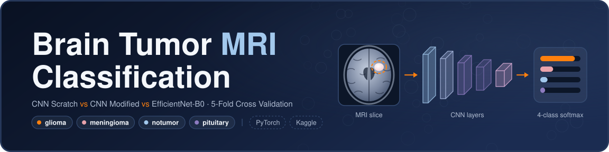
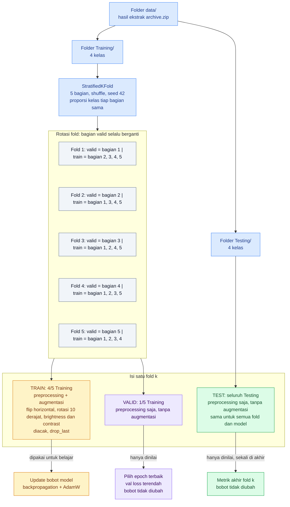
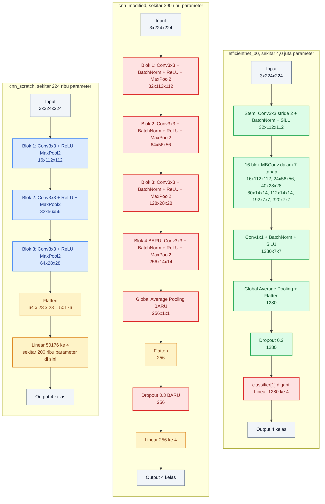
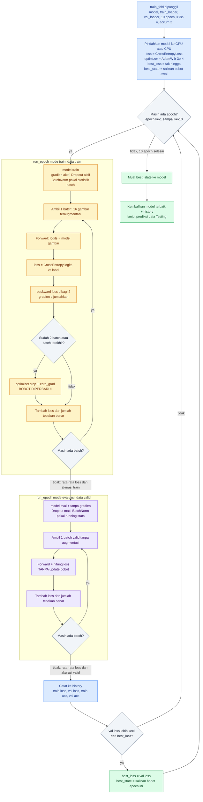

<div align="center">



**Simulasi tugas W10 Studi Kasus Pembelajaran Mesin: klasifikasi citra MRI tumor otak dengan 3 model dan 5-fold
cross validation.**


</div>

## Ringkasan

Tugas aslinya (MonkeyPox) dikerjakan ulang dengan dataset lain, yaitu
[Brain Tumor MRI Dataset](https://www.kaggle.com/datasets/masoudnickparvar/brain-tumor-mri-dataset). Dataset ini
punya 4 kelas (`glioma`, `meningioma`, `notumor`, `pituitary`), 5.600 gambar `Training` dan 1.600 gambar `Testing`.

| Model | Arsitektur | Parameter |
| --- | --- | --- |
| `cnn_scratch` | 3 blok Conv-ReLU-MaxPool (16-32-64) → Flatten → Linear | 224 rb |
| `cnn_modified` | 4 blok Conv-**BatchNorm**-ReLU-MaxPool (32-64-128-256) → **Global Avg Pool** → **Dropout 0.3** → Linear | 390 rb |
| `efficientnet_b0` | EfficientNet-B0 [1] pretrained ImageNet, layer terakhir diganti 4 kelas | 4,0 jt |

## Cara Menjalankan

1. Ekstrak `archive.zip` dari Kaggle ke folder `data/` sehingga ada `data/Training/` dan `data/Testing/`.
2. Install PyTorch CUDA 12.8, lalu paket lainnya:

```bash
pip install torch==2.11.0 torchvision==0.26.0 torchaudio==2.11.0 --index-url https://download.pytorch.org/whl/cu128
pip install -r requirements.txt
python -c "import torch; print(torch.__version__, torch.cuda.is_available())"   # harus: 2.11.0+cu128 True
```

3. Jalankan:

```bash
python main.py                                     # 3 model x 5 fold + evaluasi + grafik
python main.py --epochs 1                          # uji cepat
python main.py --models cnn_scratch cnn_modified   # hanya model tertentu
pytest                                             # tes dengan dataset sintetis
```

Semua hyperparameter ada di `src/config.py`. Default `device = "cuda"` dengan mixed precision bfloat16; program
berhenti jika CUDA tidak terdeteksi (ubah ke `"cpu"` bila tidak punya GPU NVIDIA).

## Struktur

```text
main.py                  pipeline lengkap
data/                    Training/ dan Testing/ (tidak di-upload)
src/
├── config.py            hyperparameter dan path
├── data/
│   ├── dataset.py       baca gambar, Dataset PyTorch, 5 fold stratified
│   └── preprocess.py    crop tepi hitam, resize, augmentasi, normalisasi
├── models/
│   ├── blocks.py        conv_block bersama
│   ├── cnn_scratch.py   model 1
│   ├── cnn_modified.py  model 2
│   └── efficientnet.py  model 3
├── training/
│   └── trainer.py       loop train/valid, simpan bobot terbaik, prediksi
└── evaluation/
    ├── metrics.py       accuracy, precision, recall, F1, ROC-AUC
    └── plots.py         kurva training, confusion matrix, ROC, perbandingan
tests/test_pipeline.py   tes semua komponen
```

## Alur Kerja

### Alur kerja keseluruhan

```mermaid
flowchart TD
    START["python main.py<br/>opsi: --epochs, --folds, --models"]

    subgraph PREP["1. Persiapan data"]
        direction TB
        SEED["Set seed 42<br/>random, numpy, torch<br/>main.py"]
        CEK{"Ada data/Training<br/>dan data/Testing?"}
        ERR["Berhenti: FileNotFoundError<br/>ekstrak archive.zip ke data/"]
        LIST["Baca kelas dan path gambar<br/>Training/ dan Testing/<br/>glioma, meningioma, notumor, pituitary<br/>src/data/dataset.py"]
        PPNG["Contoh preprocessing 1 gambar per kelas<br/>asli vs crop + resize<br/>src/evaluation/plots.py"]
        TF["Muat semua gambar sekali ke RAM: crop + resize 224<br/>transform train: augmentasi, valid dan test: tanpa<br/>src/data/preprocess.py"]
        FOLD["Bagi Training jadi 5 fold<br/>StratifiedKFold, shuffle, seed 42<br/>src/data/dataset.py"]
    end

    subgraph CV["2. Cross validation: loop model x fold"]
        direction TB
        MODEL["Untuk setiap model<br/>cnn_scratch, cnn_modified, efficientnet_b0"]
        subgraph PERFOLD["Untuk setiap fold k = 1 sampai 5"]
            direction TB
            BUILD["Buat model baru dengan bobot awal<br/>build_model<br/>src/models/"]
            LOADER["DataLoader batch 16<br/>train: 4/5 Training, diacak, drop_last<br/>valid: 1/5 Training<br/>main.py"]
            TRAIN["Latih 10 epoch<br/>CrossEntropyLoss, AdamW lr 3e-4<br/>grad accumulation 2, bf16<br/>simpan bobot val loss terendah<br/>src/training/trainer.py"]
            PRED["Prediksi data Testing<br/>probabilitas softmax<br/>src/training/trainer.py"]
            MET["Hitung metrik test<br/>accuracy, precision, recall, F1 macro<br/>ROC-AUC one-vs-rest macro<br/>src/evaluation/metrics.py"]
            PLOT["Grafik fold k<br/>kurva training, confusion matrix, ROC<br/>src/evaluation/plots.py"]
        end
        NEXTF{"Masih ada fold?"}
        NEXTM{"Masih ada model?"}
    end

    subgraph SUM["3. Rangkuman hasil"]
        direction TB
        AGG["Rata-rata ± std metrik dari 5 fold<br/>per model<br/>src/evaluation/metrics.py"]
        TAB["Tabel Markdown per fold + perbandingan<br/>main.py"]
        BAR["Diagram batang perbandingan model<br/>src/evaluation/plots.py"]
    end

    subgraph OUT["Folder outputs/"]
        direction TB
        O1["preprocessing.png"]
        O2["figures/nama_model/<br/>foldk_history.png<br/>foldk_cm.png<br/>foldk_roc.png"]
        O3["results.md"]
        O4["comparison.png"]
    end

    START --> SEED --> CEK
    CEK -->|"tidak"| ERR
    CEK -->|"ya"| LIST
    LIST --> PPNG --> TF --> FOLD --> MODEL
    MODEL --> BUILD --> LOADER --> TRAIN --> PRED --> MET --> PLOT --> NEXTF
    NEXTF -->|"ya"| BUILD
    NEXTF -->|"tidak"| NEXTM
    NEXTM -->|"ya"| MODEL
    NEXTM -->|"tidak"| AGG
    AGG --> TAB
    AGG --> BAR
    PPNG -.-> O1
    PLOT -.-> O2
    TAB -.-> O3
    BAR -.-> O4

    classDef data fill:#dbeafe,stroke:#3b82f6,color:#1e3a8a
    classDef train fill:#fef3c7,stroke:#d97706,color:#78350f
    classDef eval fill:#dcfce7,stroke:#16a34a,color:#14532d
    classDef out fill:#fce7f3,stroke:#db2777,color:#831843
    classDef dec fill:#f1f5f9,stroke:#64748b,color:#0f172a
    class START,SEED,LIST,TF,FOLD,LOADER data
    class MODEL,BUILD,TRAIN train
    class PRED,MET,AGG eval
    class PPNG,PLOT,TAB,BAR,O1,O2,O3,O4 out
    class CEK,NEXTF,NEXTM,ERR dec
```



### Pembagian data 5-fold



### Arsitektur model



### Loop training per epoch



## Metode

- **Pembagian data:** `Training` dibagi 5 fold stratified (4 bagian train, 1 bagian valid). `Testing` hanya untuk
  testing. Data valid/test tidak pernah dipakai untuk update bobot.
- **Preprocessing:** crop tepi hitam MRI dan resize 224x224 dilakukan sekali di awal (hasil disimpan di RAM, ~1,1 GB),
  lalu normalisasi ImageNet. Augmentasi khusus train: flip horizontal, rotasi ±10°, brightness/contrast jitter.
- **Loss / optimizer:** CrossEntropyLoss, AdamW (lr 3e-4), 10 epoch, GPU CUDA + autocast bfloat16. Batch 16 dengan
  gradient accumulation 2 langkah (batch efektif 32). Bobot dengan val loss terendah dipakai saat testing.
- **Evaluasi:** confusion matrix, accuracy, precision, recall, F1 (macro), ROC-AUC (one-vs-rest) pada `Testing`,
  dirata-rata dari 5 fold.

## Hasil

Tempel isi `outputs/results.md` setelah `python main.py` selesai:

| Model | accuracy | precision | recall | f1 | roc_auc |
| --- | --- | --- | --- | --- | --- |
| cnn_scratch | ... | ... | ... | ... | ... |
| cnn_modified | ... | ... | ... | ... | ... |
| efficientnet_b0 | ... | ... | ... | ... | ... |

Gambar: `outputs/preprocessing.png`, `outputs/comparison.png`, dan `outputs/figures/<model>/fold{k}_{history,cm,roc}.png`.

## Kerangka Laporan (Template Engineering)

Abstrak (150-200 kata) → Pendahuluan → Kajian Teori (CNN, BatchNorm, dropout, transfer learning, metrik) → Metode
(bagian di atas) → Hasil dan Pembahasan (tabel + grafik, efek tiap modifikasi, scratch vs pretrained, kelas yang
sering tertukar) → Kesimpulan → Referensi (IEEE).

> Jangan upload dataset (`data/`) atau bobot model (`*.pt`, `*.pth`) ke GitHub; sudah diatur di `.gitignore`.

## Referensi

[1] M. Tan and Q. V. Le, "EfficientNet: Rethinking Model Scaling for Convolutional Neural Networks," in *Proc. ICML*,
1.    [arXiv:1905.11946](https://arxiv.org/abs/1905.11946)