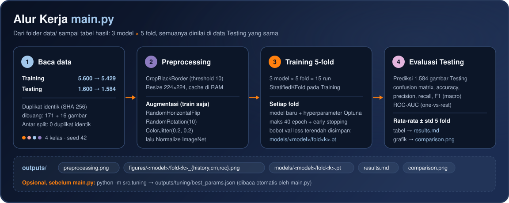
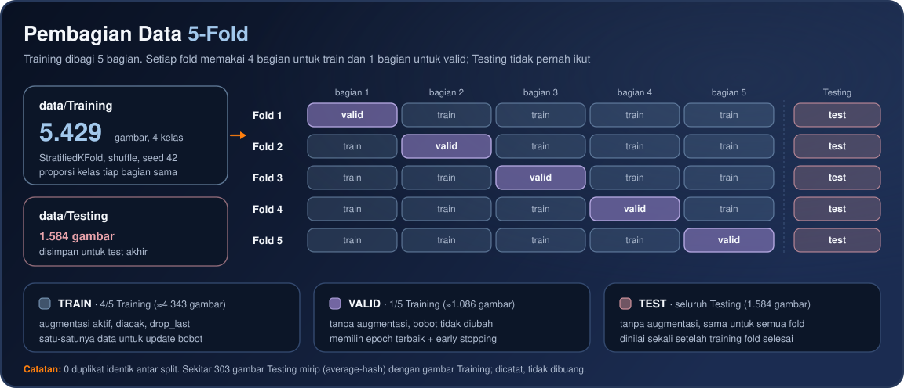
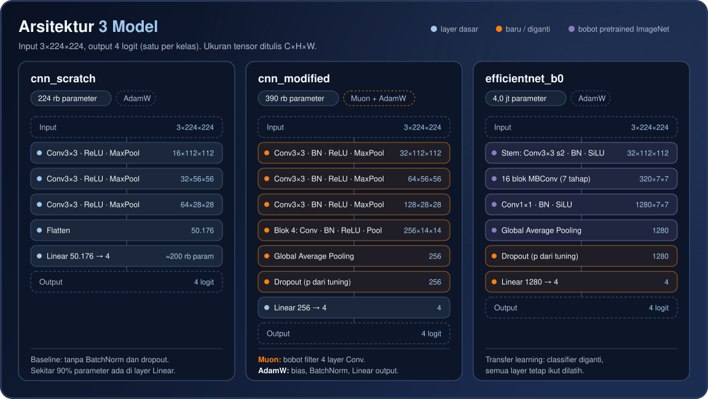
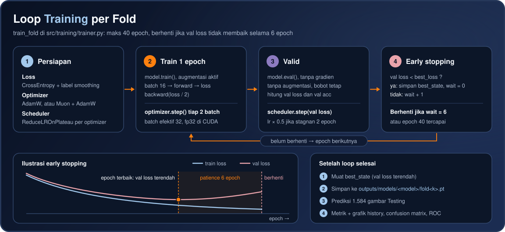
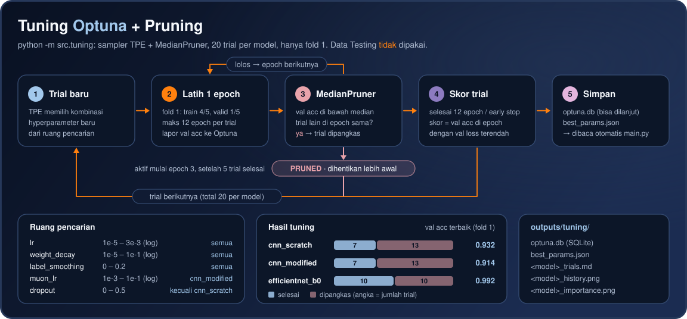

<div align="center">


**Simulasi tugas W10 Studi Kasus Pembelajaran Mesin: klasifikasi citra MRI tumor otak dengan 3 model dan 5-fold
cross validation.**


</div>

## Ringkasan

Tugas aslinya (MonkeyPox) dikerjakan ulang dengan dataset lain, yaitu
[Brain Tumor MRI Dataset](https://www.kaggle.com/datasets/masoudnickparvar/brain-tumor-mri-dataset). Dataset ini
punya 4 kelas (`glioma`, `meningioma`, `notumor`, `pituitary`), 5.600 gambar `Training` dan 1.600 gambar `Testing`
(setelah duplikat dibuang: 5.429 dan 1.584).

| Model | Arsitektur | Optimizer | Parameter |
| --- | --- | --- | --- |
| `cnn_scratch` | 3 blok Conv-ReLU-MaxPool (16-32-64) → Flatten → Linear | AdamW | 224 rb |
| `cnn_modified` | 4 blok Conv-**BatchNorm**-ReLU-MaxPool (32-64-128-256) → **Global Avg Pool** → **Dropout** → Linear | **Muon** (filter konvolusi) + AdamW (sisanya) | 390 rb |
| `efficientnet_b0` | EfficientNet-B0 [1] pretrained ImageNet, layer terakhir diganti 4 kelas | AdamW | 4,0 jt |

## Cara Menjalankan

1. Ekstrak `archive.zip` dari Kaggle ke folder `data/` sehingga ada `data/Training/` dan `data/Testing/`.
2. Install PyTorch CUDA 12.8, lalu paket lainnya:

```bash
pip install torch==2.11.0 torchvision==0.26.0 torchaudio==2.11.0 --index-url https://download.pytorch.org/whl/cu128
pip install -r requirements.txt
python -c "import torch; print(torch.__version__, torch.cuda.is_available())"   # harus: 2.11.0+cu128 True
```

3. (Disarankan) cari hyperparameter terbaik dengan Optuna. Hasilnya disimpan di `outputs/tuning/` dan otomatis
   dipakai `main.py`. Jika terhenti, jalankan lagi perintah yang sama untuk melanjutkan.

```bash
python -m src.tuning                               # 20 trial per model, semua model
python -m src.tuning --trials 10 --models cnn_scratch
```

4. Jalankan:

```bash
python main.py                                     # 3 model x 5 fold + evaluasi + grafik
python main.py --epochs 1                          # uji cepat
python main.py --models cnn_scratch cnn_modified   # hanya model tertentu
pytest                                             # tes dengan dataset sintetis
```

Semua hyperparameter ada di `src/config.py`. Default `device = "cuda"`; program berhenti jika CUDA tidak
terdeteksi (ubah ke `"cpu"` bila tidak punya GPU NVIDIA). Perkiraan waktu di RTX 3050 Laptop: tuning sekitar
3-4 jam, `main.py` sekitar 3-5 jam (EfficientNet sekitar 1 menit per epoch, CNN scratch sekitar 15-25 detik).

## Struktur

```text
main.py                  pipeline lengkap
laporan.pdf              laporan jadi
data/                    Training/ dan Testing/ (tidak di-upload)
materi/                  soal tugas (.docx), hanya lokal, diabaikan git
report/                  sumber LaTeX laporan, hanya lokal, diabaikan git
assets/                  banner dan ilustrasi README (SVG)
outputs/
├── models/              bobot terbaik <model>/fold<k>.pt (tidak di-upload)
├── figures/             kurva training, confusion matrix, ROC per fold
├── tuning/              hasil Optuna, best_params.json
└── results.md           tabel hasil
src/
├── config.py            hyperparameter dan path
├── data/
│   ├── dataset.py       baca gambar, Dataset PyTorch, 5 fold stratified
│   └── preprocess.py    crop tepi hitam, resize, augmentasi, normalisasi
├── models/
│   ├── blocks.py        conv_block bersama
│   ├── cnn_scratch.py   model 1
│   ├── cnn_modified.py  model 2
│   └── efficientnet.py  model 3
├── training/
│   ├── trainer.py       loop train/valid, early stopping, optimizer, prediksi
│   └── muon.py          optimizer Muon untuk filter konvolusi hidden layer
├── tuning/
│   ├── search.py        Optuna: ruang pencarian, objective, pruning
│   ├── report.py        tabel trial dan grafik tuning
│   └── __main__.py      perintah python -m src.tuning
└── evaluation/
    ├── metrics.py       accuracy, precision, recall, F1, ROC-AUC
    └── plots.py         kurva training, confusion matrix, ROC, perbandingan
tests/test_pipeline.py   tes semua komponen
```

## Alur Kerja

<p align="center"></p>

Gambaran besar `main.py`: data dibersihkan, diproses sekali, lalu setiap model dilatih 5 kali (satu per fold) dan
dinilai di data `Testing`. Semua hasil masuk ke folder `outputs/`.

<p align="center"></p>

`Training` dibagi 5 bagian dengan proporsi kelas yang sama. Bagian valid bergiliran tiap fold, sedangkan `Testing`
tidak pernah dipakai untuk belajar atau memilih model.

<p align="center"></p>

Tiga model dari yang paling sederhana sampai transfer learning. Kotak oranye menandai bagian yang baru atau diganti
dibanding `cnn_scratch`.

<p align="center"></p>

Satu fold: train dan valid bergantian tiap epoch sampai early stopping. Bobot dengan val loss terendah dipakai untuk
testing dan disimpan ke `outputs/models/`.

<p align="center"></p>

Optuna mencoba 20 kombinasi hyperparameter per model di fold 1. Trial yang tertinggal dari median dihentikan lebih
awal supaya waktu tidak terbuang.

## Metode

- **Pembersihan data:** gambar dengan isi file identik (hash SHA-256) dibuang: 171 di `Training`, 16 di `Testing`.
  Tanpa langkah ini gambar yang sama bisa masuk train dan valid sekaligus, sehingga model terlihat bagus karena
  menghafal.
- **Pembagian data:** `Training` dibagi 5 fold stratified (4 bagian train, 1 bagian valid). `Testing` hanya untuk
  testing. Data valid/test tidak pernah dipakai untuk update bobot.
- **Preprocessing:** crop tepi hitam MRI dan resize 224x224 dilakukan sekali di awal (hasil disimpan di RAM, ~1,1 GB),
  lalu normalisasi ImageNet. Augmentasi khusus train: flip horizontal, rotasi ±10°, brightness/contrast jitter.
- **Training:** CrossEntropyLoss dengan label smoothing [4], AdamW dengan weight decay [3], batch 16 dengan gradient
  accumulation 2 (batch efektif 32), fp32 di GPU. Learning rate dibagi 2 jika val loss stagnan 2 epoch. Maksimal 40
  epoch dengan early stopping (berhenti jika val loss tidak membaik 6 epoch), lalu bobot dengan val loss terendah
  dipakai saat testing. Khusus `cnn_modified`, filter konvolusi hidden layer dilatih dengan Muon [5] (momentum
  yang arah update-nya diortogonalkan dengan iterasi Newton-Schulz), sedangkan bias, BatchNorm, dan layer output
  tetap AdamW. `torch.optim.Muon` hanya menerima bobot 2D, jadi `src/training/muon.py` meratakan filter
  [out, in, 3, 3] menjadi matriks [out, in x 9]. Mixed precision bfloat16 sempat dicoba tetapi membuat training
  tidak stabil (val loss melonjak dan akurasi turun ke tebakan acak) tanpa mempercepat, jadi dihapus.
- **Tuning:** Optuna [2] (sampler TPE, MedianPruner) mencari `lr`, `muon_lr` (cnn_modified), `weight_decay`,
  `label_smoothing`, dan `dropout` (20 trial per model, maksimal 12 epoch per trial) hanya di fold 1. Trial yang
  akurasi validnya di bawah median dipangkas lebih awal. `Testing` tidak pernah dipakai saat tuning.
- **Menghafal atau memahami?** `results.md` mencatat akurasi train, valid, dan test di epoch terbaik setiap fold.
  Akurasi train jauh di atas valid/test berarti model menghafal (overfitting). Jika selisihnya kecil dan akurasi
  test mendekati valid, model menangkap pola yang berlaku untuk gambar baru.
- **Evaluasi:** confusion matrix, accuracy, precision, recall, F1 (macro), ROC-AUC (one-vs-rest) pada `Testing`,
  dirata-rata dari 5 fold.

## Hasil

Rata-rata ± std dari 5 fold pada data `Testing` (1.584 gambar), disalin dari `outputs/results.md`. Tabel per fold
(termasuk akurasi train dan valid) ada di file yang sama, hasil tuning di `outputs/tuning/`.

| Model | accuracy | precision | recall | f1 | roc_auc |
|---|---|---|---|---|---|
| cnn_scratch | 0.9227 ± 0.0040 | 0.9253 ± 0.0047 | 0.9215 ± 0.0040 | 0.9205 ± 0.0041 | 0.9766 ± 0.0013 |
| cnn_modified | 0.9237 ± 0.0050 | 0.9296 ± 0.0050 | 0.9224 ± 0.0050 | 0.9214 ± 0.0051 | 0.9822 ± 0.0012 |
| efficientnet_b0 | 0.9615 ± 0.0042 | 0.9641 ± 0.0035 | 0.9606 ± 0.0042 | 0.9606 ± 0.0041 | 0.9920 ± 0.0022 |

Hyperparameter yang dipakai (hasil tuning, `outputs/tuning/best_params.json`):

| Model | optimizer | lr | muon_lr | weight_decay | label_smoothing | dropout |
|---|---|---|---|---|---|---|
| cnn_scratch | AdamW | 1.15e-03 | - | 7.07e-05 | 3.64e-02 | - |
| cnn_modified | Muon + AdamW | 8.47e-05 | 1.58e-02 | 6.35e-02 | 1.46e-01 | 7.80e-02 |
| efficientnet_b0 | AdamW | 3.08e-04 | - | 6.80e-03 | 4.12e-03 | 4.85e-01 |

- **EfficientNet-B0 paling baik** di semua metrik (accuracy sekitar 0.96, ROC-AUC 0.99). Bobot pretrained ImageNet
  membuat model ini sudah "kenal" tepi dan tekstur sebelum melihat MRI.
- **cnn_modified vs cnn_scratch:** accuracy dan F1 hampir sama (selisih sekitar 0.001, masih di dalam std), tetapi
  ROC-AUC cnn_modified lebih tinggi (0.982 vs 0.977). Artinya skor probabilitasnya lebih baik dalam memisahkan
  kelas, walaupun jumlah tebakan benarnya hampir sama.
- **Menghafal atau memahami?** Rata-rata selisih akurasi train dan valid di epoch terbaik: cnn_scratch sekitar 0.046
  (train 0.995, valid 0.948), cnn_modified sekitar 0.012, efficientnet_b0 sekitar 0.001. BatchNorm, global average
  pooling, dan dropout di cnn_modified mengurangi gejala menghafal pada cnn_scratch.
- Akurasi test semua model sedikit di bawah akurasi valid, jadi skor valid (yang dipakai memilih epoch) agak
  optimistis. Karena itu angka akhir selalu diambil dari `Testing`.

Gambar: `outputs/preprocessing.png`, `outputs/comparison.png`, dan `outputs/figures/<model>/fold{k}_{history,cm,roc}.png`.

### Bobot model

Bobot terbaik setiap fold disimpan di `outputs/models/<model>/fold<k>.pt` (tidak ikut di-push karena `*.pt` ada di
`.gitignore`). Hasil di atas berasal dari run sebelum fitur ini ditambahkan, jadi jalankan `python main.py` sekali
lagi untuk mendapatkan file bobotnya (angkanya bisa bergeser sedikit). Cara memuat salah satunya:

```python
import torch
from src.models import build_model

model = build_model("efficientnet_b0", 4, 224, pretrained=False)
model.load_state_dict(torch.load("outputs/models/efficientnet_b0/fold1.pt", map_location="cpu"))
model.eval()
```

## Laporan

Laporan lengkap mengikuti Template Engineering: [`laporan.pdf`](laporan.pdf). Isinya: abstrak, pendahuluan, kajian teori, metode, hasil dan pembahasan, kesimpulan, dan
referensi (IEEE).

> Jangan upload dataset (`data/`) atau bobot model (`*.pt`, `*.pth`) ke GitHub; sudah diatur di `.gitignore`.
> Folder `materi/` (file soal tugas .docx) dan `report/` (sumber LaTeX laporan) juga hanya disimpan lokal dan
> diabaikan git.

## Referensi

[1] M. Tan and Q. V. Le, "EfficientNet: Rethinking Model Scaling for Convolutional Neural Networks," in *Proc. ICML*, 2019.
[arXiv:1905.11946](https://arxiv.org/abs/1905.11946)

[2] T. Akiba, S. Sano, T. Yanase, T. Ohta, and M. Koyama, "Optuna: A Next-generation Hyperparameter Optimization
Framework," in *Proc. KDD*, 2019. [arXiv:1907.10902](https://arxiv.org/abs/1907.10902)

[3] I. Loshchilov and F. Hutter, "Decoupled Weight Decay Regularization," in *Proc. ICLR*, 2019.
[arXiv:1711.05101](https://arxiv.org/abs/1711.05101)

[4] C. Szegedy, V. Vanhoucke, S. Ioffe, J. Shlens, and Z. Wojna, "Rethinking the Inception Architecture for Computer
Vision," in *Proc. CVPR*, 2016. [arXiv:1512.00567](https://arxiv.org/abs/1512.00567)

[5] K. Jordan et al., "Muon: An optimizer for hidden layers in neural networks," 2024. [Online].
Available: [kellerjordan.github.io/posts/muon](https://kellerjordan.github.io/posts/muon/)